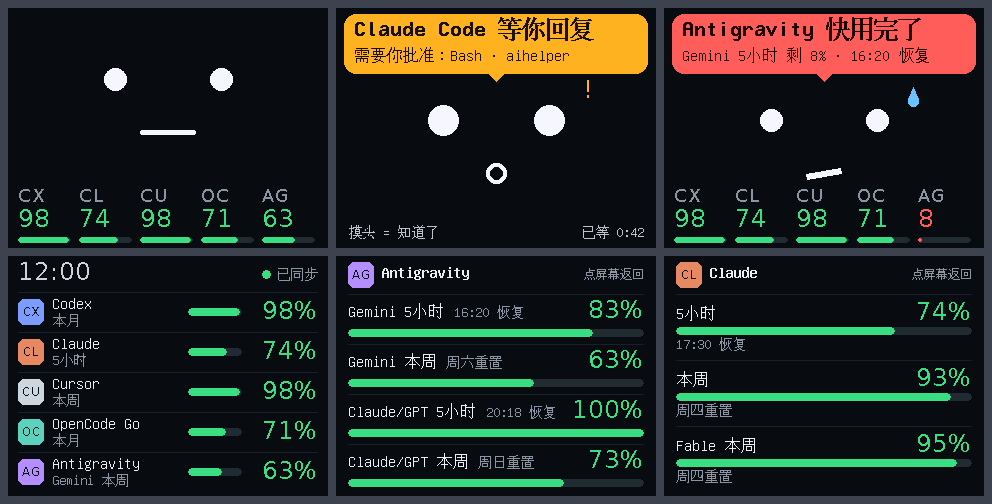
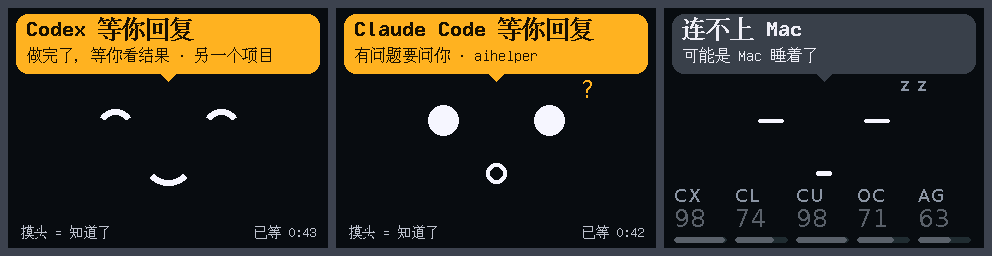

# StackChan AI 额度小摆件

把一台 [M5Stack StackChan](https://docs.m5stack.com/en/StackChan) 变成桌面小摆件：

- **平时**显示你各家 AI 订阅还剩多少额度（Claude、Codex、Cursor、OpenCode、Antigravity 等，CodexBar 支持的都行）。
- **任何一个 AI 编程助手在等你回复时**，它会变脸、点一下头、亮琥珀色灯、响一声。摸它的头表示「知道了」。

> A desk gadget built on M5Stack StackChan (CoreS3). It shows the remaining quota of your AI subscriptions and nods, lights up and chimes when any AI coding agent is waiting for you. macOS only. Docs are in Chinese.



上图是固件把自己的画面通过 USB 传回来的截图（演示数据）：平时、要你批准、额度快用完、明细列表、单个订阅。



做完了是笑脸，有问题问你是问号，连不上 Mac 会睡着。

## 它怎么工作

```
CodexBar 命令行 ──┐
                  ├─▶ Mac 上的小管家 ── WiFi ──▶ StackChan
peon-ping ────────┘     bridge/butler.py           firmware/
```

- **额度**来自 [CodexBar](https://github.com/steipete/CodexBar) 的命令行（`codexbar usage --format json`），每 5 分钟读一次。
- **「等你回复」**来自 [peon-ping](https://github.com/PeonPing/peon-ping)：它负责盯住各个 AI 工具，我们把它的「手机推送」地址指到本机的小管家。
- **小管家**是一个只用 Python 标准库写的后台小程序，把两路信息整理成一份很小的状态（`GET /state`）。
- **固件**每 2 秒来取一次状态，负责显示、点头、亮灯、出声。

这个项目自己不往任何 AI 工具里加钩子，钩子由 peon-ping 安装时登记。

## 需要准备

- 一台 Mac（只在 macOS 上用过）
- M5Stack StackChan（K151，主机是 CoreS3）
- [CodexBar](https://github.com/steipete/CodexBar) 应用，并装好它的命令行
- [peon-ping](https://github.com/PeonPing/peon-ping)
- 2.4G WiFi，设备和 Mac 在同一个局域网
- Python 3.9 或更新（macOS 自带的就行）

## 安装

```bash
git clone https://github.com/rayraid/stackchan-ai-quota.git
cd stackchan-ai-quota
```

### 1. 小管家

```bash
python3 bridge/butler.py
```

然后在浏览器打开 `http://127.0.0.1:8787/`，会看到一台用真实数据驱动的模拟设备，可以先在这里确认额度读得对。

首次运行会生成 `bridge/config.json`（参考 `bridge/config.example.json`）。要让真机连上来，把其中的 `listen` 改成 `0.0.0.0`。局域网里的访问必须带配置里自动生成的口令，本机访问不需要。

想开机自启，参考 `bridge/com.aihelper.butler.plist.example`。

### 2. CodexBar

确认命令行能读到你的订阅：

```bash
codexbar usage --format json
```

如果 Claude 读不到，运行下面这条并在系统弹窗里点「始终允许」：

```bash
codexbar cookie refresh --provider claude --allow-keychain-prompt
```

可选：在 `~/.config/codexbar/config.json` 里加上 `"shareUsageWithCLI": true`。这样命令行某一轮没读到某一家时，小管家会用 CodexBar 应用写出的共享文件顶上。

### 3. peon-ping

装好 peon-ping 后，编辑 `~/.claude/hooks/peon-ping/config.json`：

```json
{
  "volume": 0.0,
  "desktop_notifications": false,
  "notification_title_ide": true,
  "mobile_notify": {
    "enabled": true,
    "service": "ntfy",
    "topic": "aihelper",
    "server": "http://127.0.0.1:8787/ntfy"
  }
}
```

音量调成 0 是因为提示音交给小摆件来出。不要用 `peon pause` 来静音，那会连推送一起停掉。

### 4. 固件

```bash
python3 -m venv .venv
.venv/bin/pip install platformio esptool
```

**烧录会覆盖设备出厂固件，先备份：**

```bash
.venv/bin/python -m esptool --port /dev/cu.usbmodemXXXX read_flash 0 0x1000000 factory-backup.bin
```

编译并烧录（小管家要先运行过一次，固件编译时会读取它的口令和这台 Mac 的名字）：

```bash
cd firmware
../.venv/bin/pio run -t upload
```

第一次开机，屏幕会提示用手机连接热点 `StackChan-Setup`，在弹出的页面里选你家的 WiFi 并输入密码。之后它会自己找到 Mac 上的小管家。

## 它的反应

| 情况 | 屏幕 | 头 | 灯 | 声音 |
|---|---|---|---|---|
| 平时 | 一张脸加底部额度条 | 微微抬头 | 微弱的绿色 | 不响 |
| AI 要你批准 | 睁大眼加感叹号 | 点一下头 | 琥珀色呼吸 | 响一声 |
| AI 做完了 | 笑脸 | 点一下头 | 琥珀色呼吸 | 响一声 |
| 已知道但 AI 还在等 | 右上角「N 个在等」 | 不动 | 琥珀色常亮 | 不响 |
| 额度快用完 | 担心的脸 | 慢慢摇一次头 | 红色常亮 | 不响 |
| 连不上 Mac | 睡着 | 低头 | 熄灭 | 不响 |

点屏幕可以在脸、明细列表、单个订阅之间切换。有提醒时，摸头顶或点屏幕表示「知道了」。

## 开发调试

固件可以把当前画面通过 USB 串口传回来，不看真机也能检查界面：

```bash
cd firmware
../.venv/bin/python tools/devtool.py sheet out.png "demo calm;page face" "demo approval" "demo done"
../.venv/bin/python tools/devtool.py cmd "info" "body"
```

串口命令：`info`、`body`、`shot`、`demo calm|done|approval|question|low|stale|off|exit`、`page face|list|detail <id>`、`nod`、`shake`、`droop`、`idle`、`chime`、`motion on|off`、`sound on|off`、`wifi reset`。

## 已知限制

- 只在 macOS 上用过。
- 「等你回复」目前只对 Claude Code 做过完整实测。其他工具能否提醒，取决于 peon-ping 对它们的支持。
- 设备和小管家之间是局域网里的明文 HTTP 加口令，只适合在自己家的网络里用。
- 提醒强度是固定的（点一次头、响一声），夜间静音还没做。
- 上下点头的角度在固件里限制在 5° 到 85°，这是 M5Stack 官方建议的范围。

## 致谢

- [CodexBar](https://github.com/steipete/CodexBar)：额度数据
- [peon-ping](https://github.com/PeonPing/peon-ping)：各个 AI 工具的「等你回复」信号
- [StackChan-BSP](https://github.com/m5stack/StackChan-BSP)、[M5Unified](https://github.com/m5stack/M5Unified)：舵机、彩灯、触摸、屏幕
- [ArduinoJson](https://arduinojson.org/)、[WiFiManager](https://github.com/tzapu/WiFiManager)

## 设计过程

`docs/prototype.html` 是动手之前做的交互原型（下载后用浏览器打开）：三种屏幕风格的对比、全部表情、整体方案和调研结论。最终做进固件的是其中的 A 风格，真机上的字比原型里的大。

## 许可

MIT，见 [LICENSE](LICENSE)。这是个人项目，按原样提供。
