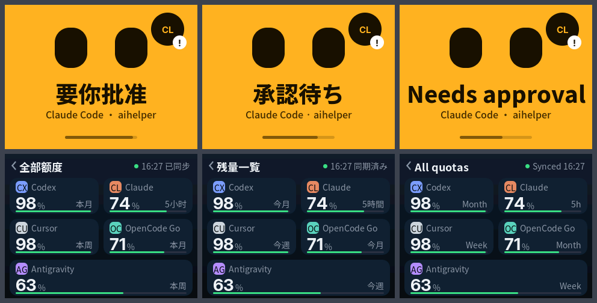

# StackChan AI 额度小摆件

把一台 [M5Stack StackChan](https://docs.m5stack.com/en/StackChan) 变成桌面小摆件：

- **平时**显示你各家 AI 订阅还剩多少额度（Claude、Codex、Cursor、OpenCode、Antigravity 等，CodexBar 支持的都行）。
- **任何一个 AI 编程助手在等你回复时**，它整屏变色、点一下头、亮灯、响一声，10 秒后回到平时的样子；要你批准、有问题、出错时，灯和右上角的小 logo 一直留到你回到那个 AI，「做完了」提醒完就熄。**不需要碰它**：机器人只负责让你看到，不要求你回应。
- Mac 上有一个菜单栏应用「小管家」：装好就能用，带安装向导和很多设置。界面和机器人屏幕支持**中文、日文、英文**。

> A desk gadget built on M5Stack StackChan (CoreS3). It shows the remaining quota of your AI subscriptions and nods, lights up and chimes when any AI coding agent is waiting for you. Comes with a macOS menu bar app (setup assistant, lots of settings). UI in Chinese, Japanese and English; docs are in Chinese.


上图是固件把自己的画面通过 USB 传回来的截图（演示数据，各家 logo 换成了字母）：首页 A（左上角是电量）、首页 B（眼睛就是额度）、要你批准、做完了、提醒过后还在等（右上角是谁在等）、额度快用完、全部额度、单个订阅的明细、提醒画面样式 C。



## 它怎么工作

```
CodexBar 命令行 ──────┐
                      ├─▶ Mac 菜单栏里的「小管家」 ── WiFi ──▶ StackChan
各 AI 工具的钩子 ─────┘     mac/（Swift）                   firmware/
```

- **额度**来自 [CodexBar](https://github.com/steipete/CodexBar) 的命令行，默认每 5 分钟读一次。装了 CodexBar 应用就用它自带的那份；没装的话，小管家第一次打开时会从 CodexBar 官方 GitHub 下载官方安装包，核对校验值和作者的苹果开发者签名后，只取出里面的命令行放在自己的目录里，之后每天看一次有没有新版。（官方单独发布的命令行压缩包没有作者签名，所以不用它。）
- **「等你回复」**来自小管家自己的钩子 `butler-hook.sh`：在设置或安装向导里点「接通」，小管家就把它登记到 Claude Code、Codex、Cursor、Antigravity 的钩子配置里（改之前在旁边留一份 `.bak-butler-…` 备份，别人加的钩子不动）。AI 停下来等你、要你批准、你回来了，这个脚本都会立刻转告小管家，自己马上返回，不卡住 AI。
- **小管家**把两路信息整理成一份很小的状态，用 Bonjour 在局域网里公布自己；机器人每 2 秒来取一次，同时拿到你在 Mac 上改的设置。
- 机器人和小管家之间的约定见 [docs/protocol.md](docs/protocol.md)。

以前的版本靠 [peon-ping](https://github.com/PeonPing/peon-ping) 转发「等你回复」，现在不需要了；已经装了 peon-ping 的照样能用，某个工具改用小管家自己的钩子后，peon-ping 再发来的同一件事会被忽略，不会提醒两次。OpenCode 暂时还要借 peon-ping 接通。

## 需要准备

- 一台 Mac（macOS 14 或更新）
- M5Stack StackChan（K151，主机是 CoreS3）和一根能传数据的 USB-C 线
- 2.4G WiFi，机器人和 Mac 在同一个局域网

## 安装

1. 下载 `StackChan-Butler-2.0.0.dmg`，把「StackChan Butler」拖进「应用程序」，打开它。
2. 第一次打开会出现安装向导，跟着走一遍（大约 5 分钟）：
   1. **读取额度和提醒**：读额度的组件小管家自己准备（见上面）；授权读取 Claude 的额度；给每个 AI 工具点「接通」。Codex 出于安全，还要你在 Codex 里输入 `/hooks` 信任一次。
   2. **连接机器人**：用 USB 线插上 StackChan，一键装固件。默认先备份出厂固件（大约 1 分钟，存在 `~/Library/Application Support/StackChan Butler/Backups`），以后可以一键恢复。
   3. **连上 WiFi**：WiFi 名称和密码通过 USB 线直接写进机器人，不经过网络。
   4. **完成**：机器人点一下头，可以再发一条测试提醒。显示哪些 AI、机器人长什么样都有默认值，以后在设置里改。
3. macOS 问「是否允许 StackChan Butler 查找本地网络上的设备」时，请点「允许」，机器人靠它找到这台 Mac。

以后点菜单栏的小机器人图标，能看到连接状态和各家还剩多少，开关勿扰、打开设置（⌘,）。菜单栏图标被系统藏起来时，在「应用程序」里再打开一次小管家，就会弹出设置窗口。

> 如果下载的安装包没有经过苹果公证，第一次打开会被系统拦住：到「系统设置 → 隐私与安全性」里点「仍要打开」。

## 它的反应

| 情况 | 屏幕 | 头 | 灯 | 声音 |
|---|---|---|---|---|
| 平时 | 首页（四种样式可选，见下面） | 微微抬头 | 微弱的绿色 | 不响 |
| AI 要你批准 / 有问题 | 整屏琥珀色，大眼睛 + 感叹号 / 问号，停 10 秒 | 点一下头 | 琥珀色呼吸 | 响一声 |
| AI 做完了 | 整屏绿色，笑眼，停 10 秒，之后什么都不留 | 点一下头 | 琥珀色呼吸，提醒完熄掉 | 响一声 |
| 整屏收起后 AI 还在等（批准、提问、出错） | 回到首页，右上角一个小 logo（是谁在等） | 不动 | 琥珀色常亮 | 不响 |
| 额度快用完 | 红色卡片「只剩 N%」，担心的眼睛，1 分钟后收进首页（数字留红） | 慢慢摇一次头 | 红色常亮 | 不响 |
| 数据一时没更新 | 数字变灰，左上角「数据停在 HH:MM」 | 不动 | 照常 | 不响 |
| Mac 锁屏、睡眠 / 连不上 | 睡着 | 低头 | 熄灭 | 不响 |

整屏提醒默认停 10 秒。「做完了」默认提醒完就熄，不挂 logo、不亮灯；「要你批准」「有问题问你」「出错了」的灯和小 logo 留到你回去。这些和提醒画面的样子（经典整屏 / 柔和变色 / 脸 + 卡片）都能在设置里改。几个 AI 同时等你时，按「要你批准 → 有问题 → 出错 → 做完了」一个接一个闪。你回到那个 AI 继续用，或者摸一下它的头，灯和小 logo 就消失。

### 首页样式

「设置 → 屏幕 → 首页样式」里四选一：

- **A 轻底栏**：脸在上面，下面一行 logo + 数字 + 细条。
- **B 眼睛就是额度**（默认）：两只眼睛像两个小水箱，剩多少亮多少；第三家只在快用完时以红色小胶囊出现。
- **C 说给你听**：脸在左边，额度在它旁边的对话气泡里。
- **D 只有脸**：平时没有数字，快用完时才露出那一家。

每家显示哪个额度（5 小时、本周……）可以在「屏幕」页里单独选。

四种样式的首页左上角都有一个小电池和百分比：插着线时变绿、电池里有闪电，没插线剩 20% 以下变红。电量只在首页显示，Mac 菜单栏面板顶部和「设置 → 机器人」里也能看到。

### 触摸

- **点屏幕**：首页上点某一家（A 的某一格、B 的某只眼睛、C 气泡里某一行）看它的明细，点别处看全部额度；全部额度页点某一家看它的明细，点顶部标题栏回首页；明细页点哪里都回上一页；15 秒没碰自动回到首页。
- **摸头**：有 AI 在等你（整屏提醒中，或者灯还亮着、右上角有小 logo）时，摸一下就全部熄掉，它会开心地晃一下表示收到；没有提醒时，在首页默认开心地眯眼笑、晃一下头（可改成「切换页面」或关掉），在全部额度页、明细页摸头 = 返回。
- 这些都可选，不碰它也完全没问题。

### 图标

默认每一家用彩色方块 + 两个字母（CL、CX…）。在「设置 → 订阅与数据」里点「从官网获取官方图标」，小管家会从 Anthropic、OpenAI、Cursor、OpenCode、Google 官网的品牌素材里取 logo，之后机器人和菜单栏都用 logo 显示；也可以给每一家选自己的图片。

这些 logo 是各公司的商标，**这个仓库和安装包里都不带**。它们只会存在你自己的 Mac 上（`~/Library/Application Support/StackChan Butler/Icons`），显示在你自己的机器人上。

## 设置

菜单栏 → 小管家设置…（⌘,），顶部八页，改完 2 秒内同步到机器人：

- **通用**：开机启动、菜单栏显示什么、语言（跟随系统 / 中文 / 日本語 / English）、导出导入设置、重新运行安装向导、日志
- **屏幕**：首页样式（四选一）、全部额度页样式（小卡片 / 一行一家 / 竖条）、明细页样式（大圆环 / 横条）、提醒画面样式（经典整屏 / 柔和变色 / 脸 + 卡片）、配色（深夜蓝、纯黑、暖色、浅色）、亮度、首页放哪几家、每家显示哪个额度、显示「还剩」还是「用了」、时钟、没动静多久变暗
- **表情**：眼睛样式（胶囊、圆点、竖条）和颜色、眨眼、张望、晚上犯困、名字
- **提醒**：哪些 AI 工具、哪些情况提醒，提醒强度（轻、中、强）、提醒画面停多久、再提醒、「做完了」多久后熄灯、「要你批准」最多等多久、黄线红线、额度恢复时告诉我
- **动作与声音**：点头幅度、抬头角度、偶尔转头、音量和音色、彩灯亮度和颜色、平时摸头做什么
- **勿扰**：定时勿扰、周末、勿扰时动不动响不响、Mac 锁屏时机器人也休息、临时勿扰
- **订阅与数据**：刷新频率、过期时间、订阅排序、简称和颜色、显示或隐藏、图标（从官网获取 / 自己选图片 / 用字母）
- **机器人**：连接状态、电量、找设备、改 WiFi、重新生成口令、通过 WiFi 升级固件、重启、恢复出厂固件

## 开发

### 固件（`firmware/`）

```bash
python3 -m venv .venv
.venv/bin/pip install platformio esptool freetype-py
cd firmware
../.venv/bin/pio run -t upload
```

- 屏幕字体是从 Noto Sans SC、Noto Sans JP、Inter 截取的平滑字体（`fonts/*.vlw`，SIL OFL 1.1）。改了屏幕上的文字（`src/i18n.cpp`）后重新生成：把 google/fonts 里的 `NotoSansSC[wght].ttf`、`NotoSansJP[wght].ttf`、`Inter[opsz,wght].ttf` 放进 `fonts/src/`（改名为 NotoSansSC.ttf 等），运行 `../.venv/bin/python tools/make_fonts.py fonts/src`。
- 分区表 `partitions.csv`：两份约 7.6MB 的应用区，支持 WiFi 升级。
- 不看真机也能检查画面：

```bash
../.venv/bin/python tools/devtool.py sheet out.png "demo calm" 'set {"alert_secs":0};demo approval' 'set {"home":"C"};demo low'
```

串口命令：`info`、`hello`、`cfg wifi|link|save|show|clear`、`set {设置 JSON}`、`shot`、`body`（电池电压电流）、`batt 76|batt 64 chg|batt real`（假装电量，截图用）、`icons off|on`（只画字母方块，截公开截图用）、`tap x y`、`hold x y`、`pat`、`demo calm|approval|question|done|error|waiting|low|stale|off|rest|setup|nolink|connecting|exit`、`page face|list|detail <id>`、`nod`、`shake`、`chime`、`find`、`reboot`。

### Mac 应用（`mac/`）

```bash
cd mac
scripts/build_app.sh            # 拼出 build/StackChan Butler.app（本机临时签名）
SIGN_ID="Developer ID Application: …" NOTARY_PROFILE=… scripts/build_app.sh dmg   # 签名、做 dmg、公证
```

脚本会把编译好的固件和乐鑫官方的 esptool（独立版，乐鑫已签名）一起打包进应用。`BUTLER_SNAPSHOT=<目录>` 启动时会把所有界面离屏画成 PNG，方便检查。

## 已知限制

- 小管家自己的钩子：Claude Code（`~/.claude/settings.json`）、Codex（`~/.codex/hooks.json`，并在 `config.toml` 里打开钩子功能）、Cursor（`~/.cursor/hooks.json`）、Antigravity 2（`~/.gemini/config/hooks.json`）。四家的事件都用模拟数据测过。Cursor 和 Antigravity 只会提醒「做完了」。OpenCode 暂时还要借 peon-ping。
- 设备和小管家之间是局域网里的明文 HTTP 加口令，只适合在自己家的网络里用。
- 机器人只支持 2.4G WiFi。
- 上下点头的角度在固件里限制在 5° 到 85°，这是 M5Stack 官方建议的范围。

## 致谢

- [CodexBar](https://github.com/steipete/CodexBar)（MIT）：额度数据
- [peon-ping](https://github.com/PeonPing/peon-ping)：早期版本的「等你回复」信号，也是我们写钩子时的参考
- [StackChan-BSP](https://github.com/m5stack/StackChan-BSP)、[M5Unified](https://github.com/m5stack/M5Unified)：舵机、彩灯、触摸、屏幕
- [ArduinoJson](https://arduinojson.org/)、[WiFiManager](https://github.com/tzapu/WiFiManager)
- 字体：[Noto Sans SC / JP](https://github.com/notofonts/noto-cjk)、[Inter](https://github.com/rsms/inter)（SIL Open Font License 1.1）
- 烧录：[esptool](https://github.com/espressif/esptool)（GPLv2，作为独立程序随应用分发）

## 设计过程

`docs/prototype.html` 是 1.0 动手之前做的交互原型（下载后用浏览器打开）。

## 许可

MIT，见 [LICENSE](LICENSE)。这是个人项目，按原样提供。
